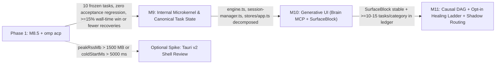

# ADR: Solline Roadmap M8.5 → M11 (Microkernel, Generative UI, Self-Learning & Self-Healing)

**Date:** 2026-11-19  
**Status:** Accepted (Phase 1 active; M9–M11 gated on M8.5 empirical evidence)  
**Scope:** Establishes objective entry gates and architectural boundaries from Phase 1 (`omp acp` + M8.5) through M11 while preserving the 2026-11-10 anti-bloat discipline.

---

## Context

Solline is a personal Windows desktop control plane orchestrating multiple coding agents (`claude`, `codex`, ACP agents) with strict three-layer separation (`packages/engine` in an Electron `utilityProcess` -> `packages/protocol` Zod IPC -> `apps/desktop/src/renderer` sandboxed React UI). Existing modules already cover turn checkpoints (`checkpoints`), parallel worktrees (`worktrees`), races & split execution (`races`), cross-vendor second opinion & handoff (`quality`, `handoff`), native rules & verified memory via the internal `Brain` MCP server (`brain`, `rules`, `memory`, `consult`), GitHub issue/PR workflow (`pull`), local usage ledger (`ledger`), and opt-in repair loop (`repair`).

Three constraints govern evolution:
1. **No speculative rewrites before measurement:** M8.5 (`pilot`) must first prove that Solline outperforms pure terminal harnesses on accepted work and active/recovery time.
2. **Structural bottlenecks:** `engine.ts` (~977 LOC), `session-manager.ts` (~2,825 LOC), and `apps/desktop/src/renderer/src/stores/app.ts` (~1,906 LOC) need decomposition before Generative UI or causal healing layers are added.
3. **Security & trust invariants:** Electron fuses (`runAsNode`, `NODE_OPTIONS`, `--inspect` disabled; ASAR integrity enabled), `frame-src 'none'` CSP, subscription-only logins (no stored provider tokens), `main`-only native confirmations/Credential Manager access, and the 2026-11-06 rule banning `AGENTS.md`/`CLAUDE.md` reading or generation.

---

## Phase Gates

### Phase 1 Exit Gate (`omp acp` + M8.5)
- **Pilot pair:** Same agent and model in pure terminal (`native-reference`) vs. inside Solline (`solline-reference`) across the 10 frozen tasks (`FROZEN_SEAL` in `packages/engine/src/pilot/corpus.ts`). A 2-task disposable dry-run precedes the frozen run to validate permissions, `_session/steering`, `session/cancel`, shadow checkpoint rewind, and telemetry.
- **Pass criteria (`evaluatePilotGate`):**
  1. All 10 frozen tasks measured on both arms (`not-measured` never coerced to `0`).
  2. Zero regression in accepted tasks (`sollineAcceptedTasks >= nativeAcceptedTasks`).
  3. Either `>= 15%` reduction in wall minutes per accepted task OR strictly fewer manual recovery interventions (`sollineManualRecoveriesTotal < nativeManualRecoveriesTotal`).
- **Hardware / Shell trigger (16 GB Windows machine):** If `sollinePeakRssMbMax > 1500` MB or `sollineColdStartMsMedian > 5000` ms, `evaluatePilotGate` flags `tauriShellReviewRecommended: true` as an objective trigger to evaluate replacing only the Electron UI shell (`apps/desktop`) with Tauri v2 while keeping `packages/engine` untouched.
- **OMP adapter trigger:** `omp acp` enters via the reviewed catalog with an enforced YAML overlay (`tools.approvalMode: always-ask` and overlapping memory/checkpoint/advisor/autolearn disabled). If `omp`'s built-in `AGENTS.md`/`CLAUDE.md` discovery measurably degrades the M8.5 run, promote `omp` to a dedicated `omp --mode rpc` adapter post-M8.5.

---

## M9: Internal Microkernel & Canonical Task State Packet

- **Architecture:** A lightweight (~200–400 LOC) internal typed event bus and module registry inside `packages/engine` (`init` / `start` / `dispose` lifecycle + Zod capability manifests in `packages/protocol`). **Do not adopt Cordis** and **do not load unreviewed third-party code or UI plugins dynamically at runtime** (preserves Electron fuses and reviewed-in-commit security). "Hot-reload" means clean `enable`/`disable` of reviewed internal modules (plus process reload in dev).
- **Decomposition target:** Split `engine.ts`, `session-manager.ts`, and `apps/desktop/src/renderer/src/stores/app.ts` into domain modules/slices before M10 lands.
- **Canonical Task State Packet:** Promote task/session handoff state to an adapter-neutral canonical object (explicitly separating original user intent from LLM-drafted handoff summaries — resolving the open M5 reviewer gap — alongside todo/plan state, checkpoint/diff refs, decisions, active native rules, used memories, and verification status). Never serialize or replay proprietary raw tool/thinking message histories across harnesses.
- **Process isolation & circuit breakers:** Keep internal state modules (`rules`, `memory`, `spaces`, `ledger`, `repair`) in-process within the engine `utilityProcess` behind error boundaries and circuit breakers for graceful degradation. Reserve process/worker isolation + circuit breakers for external boundaries: agent adapters, MCP probes/gateway (completing M6 phase 5's deferred gateway), checks/git subprocesses, and Windows Credential Manager calls.

---

## M10: Generative UI/UX (`Brain` MCP + `SurfaceBlock`)

- **Product posture ("Foco / Código" progressive disclosure):** Default "Foco" mode presents clean structured surfaces instead of raw logs or walls of prose, while keeping verification proof (changed files, check status, reviewer findings) visible and 1-click access to the M2 hunk-by-hunk Review panel. Users can toggle density ("Foco / Código") without losing auditability.
- **Protocol & emission channel:** Expose closed A2UI primitives as tools on Solline's existing **`Brain` MCP server** (uniform across Claude, Codex, and ACP agents). Synchronous Zod validation runs inside `Brain`: invalid payloads return actionable schema errors to the model for silent self-correction before emitting any delta; repeated failure falls back cleanly to plain text. Transport reuses `EngineEvent` / `ConversationDelta` + `DurableJournal` by adding a closed `SurfaceBlock` (no wire-protocol rewrite to AG-UI).
- **Strict privilege boundary:** Model-callable surfaces are strictly **non-privileged**: `DecisionCard`, `TaskProgress`, `QuestionForm` (explicitly banning secret/password/credential fields), `HealthAlert`, `DiffSummary`, `ComparisonTable`, and static/sandboxed `ArtifactPreview`. Security-sensitive actions (`ActionApproval`, `PermissionBlock`, `push`, `mcp.approve`, `trust` dialogs, credential entry) remain 100% engine/`main`-originated. `LivePreview` over `SOLLINE_PORT` remains disabled (`frame-src 'none'`) by default and requires explicit opt-in and CSP review.

---

## M11: Self-Learning & Self-Healing

- **Rules & distillation rule preserved:** The 2026-11-06 decision stands — Solline never reads or writes `CLAUDE.md` or `AGENTS.md`, and never auto-generates standing startup rules by LLM.
- **Encrypted Causal DAG:** Instead of `better-sqlite3` (native Electron rebuild friction) or plaintext `node:sqlite`, persist a lightweight causal DAG (`ErrorSignature [normaliseFailure] -> Context/Files -> Action/Harness -> VerifiedFix [commit/hunk hash]`) in encrypted JSON/NDJSON inside the existing `DurableJournal` + Windows Credential Manager key. Reuse `staleness.ts` to mark nodes "to confirm" when cited fix files change. Post-PR distillation feeds this DAG for **on-demand error-time injection** (zero prompt overhead on normal turns). Only recurring patterns backed by verified proof surface as 1-click proposals in Solline's native rules inbox; any entry touching CI/network logs is tagged `external` (one-by-one approval only).
- **Opt-in Healing Ladder (extending `RepairLoop`):**
  1. Surgical retry enriched with validated Causal DAG fix hints.
  2. Model/harness escalation using **user-configured abstract profiles** (never hardcoded model names in protocol); crossing vendors/subscriptions requires explicit per-project/session pre-authorization or 1-click confirmation.
  3. Read-only re-plan or shadow-checkpoint `rewind` suggestion.
  4. Escalate to user with ready diagnosis (diff, normalized error signature, attempts, next step).  
  Infinite-loop detection relies on observable stream heuristics (consecutive equivalent tool calls, repeated `normaliseFailure` signatures, and M8.2 turn/minute budgets).
- **Adaptive Routing:** Silently records per-task-category acceptance, checks, wall time, and recoveries in the local ledger. Advisory/shadow suggestions activate only after reaching `>= 10–15` tasks in a category and never alter default models silently.
